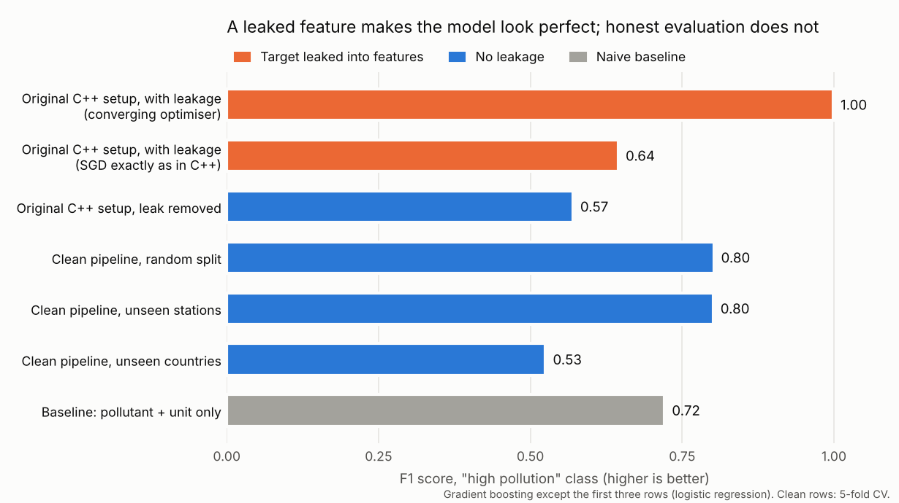

# Air quality ML: finding and fixing data leakage

[](https://github.com/carmencanobermell/air-quality-ml/actions/workflows/tests.yml)

This project started as a from-scratch C++ implementation: it loads ~54k air-quality readings from
123 countries and trains a classifier that flags "high pollution". Rebuilding it in Python revealed that
**the target had leaked into the features**. This repository is that rebuild: it reproduces the original results
exactly, isolates the effect of the leak, and then checks how much of the corrected model's score
holds up under stricter evaluation.

Stack: Python, pandas, scikit-learn, FastAPI, pytest, GitHub Actions, Docker.



**Key findings**

- With the leak, a properly trained model scores F1 = 1.00. It is not learning anything: the answer is
  one of its inputs.
- Without the leak, a clean pipeline (proper split, one-hot encoding, gradient boosting) reaches F1 = 0.80,
  and the score holds for stations the model has never seen (0.80).
- It does NOT hold for countries the model has never seen (0.53), and a naive baseline that only
  knows the pollutant and its unit already reaches 0.72. Most of the signal is "which pollutant, measured
  in which unit, in which country", not something that transfers to new places.

## Quick start

```bash
pip install -r requirements.txt
PYTHONPATH=src python -m airquality          # prints everything, writes results/metrics.json (~2 min)

pip install -r requirements-dev.txt
pytest                                       # unit tests
python validation/compare_with_cpp.py        # 25 checks against the original C++ outputs
python scripts/plot_results.py               # redraws results/f1_summary.png
```

### Docker

One image definition, two targets (`runtime` for the experiments, `dev` with tests, validation and plotting),
and a non-root user so files written to `./results` are yours:

```bash
export UID GID=$(id -g)                  # so ./results is owned by you
docker compose run --rm experiments      # full pipeline -> results/metrics.json
docker compose run --rm test             # unit tests
docker compose run --rm validate         # 25 checks against the C++ outputs
docker compose run --rm plot             # redraws results/f1_summary.png
```

CI builds the same image and runs the tests and the validation inside it.

### Serving the model

`python -m airquality.model` trains the clean pipeline (experiment 3) on all cleaned rows and saves it with
`joblib`. `airquality.api` serves it with FastAPI, and the `api` Docker target trains the model at build time and
starts the server:

```bash
docker compose up api                    # interactive docs at http://localhost:8000/docs
curl -X POST localhost:8000/predict -H 'content-type: application/json' \
     -d '{"country":"ES","pollutant":"NO2","lat":40.4,"lon":-3.7}'
# {"high_pollution":false,"probability":0.199}
```

The model inherits the limits in section 2: it knows what is typical for each country and pollutant, and it is not a
reliable predictor for places it has not seen. CI starts the API container and calls it on every push.

## Data

`data/world_air_quality.csv`: the [World Air Quality Data 2024 (Updated)](https://www.kaggle.com/datasets/kanchana1990/world-air-quality-data-2024-updated)
dataset on Kaggle, an export of [OpenAQ](https://openaq.org) readings via OpenDataSoft. Each row is the latest reading of
one pollutant at one station (mostly from early 2024), so this is a snapshot, not a time series.

For the classification experiments, 300 of the 53,635 usable rows are removed (`clean_for_modelling` in `data.py`):
readings that are physically impossible, such as CO = 3.2 million µg/m³ at Turkish stations, and rows that are not
pollutants (temperature, humidity, particle counts) or that have an inconsistent unit (PM2.5 in ppm).

## 1. The leakage experiments

The target is `1` if `value` is above its 65th percentile, so `value` must not be a feature. The original C++ model
had it as one. Four experiments isolate each change (hold-out test set, positive class = "high pollution"):

| Experiment | Model | Precision | Recall | F1 | ROC-AUC |
|---|---|---|---|---|---|
| 1. C++ replica, **with** leakage | SGD (as in C++) | 0.547 | 0.786 | 0.645 | 0.754 |
| 1. C++ replica, **with** leakage | L-BFGS | 0.998 | 1.000 | **0.999** | 1.000 |
| 2. Same, `value` removed | SGD (as in C++) | 0.547 | 0.786 | 0.645 | 0.753 |
| 2. Same, `value` removed | L-BFGS | 0.678 | 0.492 | 0.570 | 0.753 |
| 3. Clean pipeline | Logistic regression | 0.729 | 0.731 | 0.730 | 0.888 |
| 3. Clean pipeline | Gradient boosting | 0.855 | 0.740 | **0.794** | 0.942 |
| 4. Per-pollutant label | Logistic regression | 0.587 | 0.411 | 0.483 | 0.709 |
| 4. Per-pollutant label | Gradient boosting | 0.741 | 0.529 | 0.618 | 0.823 |

- **The leak was real but, in the original C++ code, inert.** Min-max scaling `value` over a column with outliers up
  to 3.2 million squeezes typical readings into a range of about 1e-5. Per-sample SGD with learning rate 0.1 cannot grow
  a weight large enough to use it, so the C++ model scores F1 = 0.645 with or without `value`. An optimiser that
  converges (L-BFGS) uses it immediately and reaches F1 = 0.999. Whether the bug shows up depends on the optimiser and
  the feature scale.
- **Experiment 3** fixes more than the leak: implausible readings removed, shuffled stratified split (the CSV is ordered
  in blocks, so a sequential 80/20 split tests on different regions than it trains on), scaler fitted on the training
  set only, and one-hot encoding of `pollutant` and `country` instead of ordinal indices.
- **Experiment 4 is the harder task.** Experiment 3 puts every pollutant and unit on one scale (CO in µg/m³ is in the
  hundreds, NO2 in ppm is around 0.003), so knowing the pollutant already says a lot. Defining "high" relative to each
  (pollutant, unit) group removes that shortcut.

## 2. How much of the clean score is real?

Experiments 3 and 4 use one random split. `robustness_checks` in `classify.py` re-evaluates them with 5-fold
cross-validation, with folds that keep whole stations or whole countries out of training, and against a baseline
(F1 / ROC-AUC, gradient boosting unless noted):

| Evaluation | Global label | Per-pollutant label |
|---|---|---|
| Random folds | 0.802 / 0.943 | 0.610 / 0.824 |
| Unseen stations | 0.801 / 0.942 | 0.608 / 0.820 |
| Unseen countries | 0.525 / 0.711 | 0.287 / 0.590 |
| Baseline: pollutant + unit only (logistic regression) | 0.721 / 0.888 | 0.000 / 0.507 |

- **Unseen stations:** no drop. A station appearing in both training and test (with different pollutants) does not
  inflate the score.
- **Baseline:** for the global label, pollutant + unit alone gets within 0.08 F1 of the full model. Logistic regression
  with all features (0.735) barely beats it. With the per-pollutant label the baseline is useless by construction,
  which confirms that label removes the shortcut.
- **Unseen countries:** the score collapses, and with the per-pollutant label it is close to chance (ROC-AUC 0.59).
  The model learns what is typical for each country and does not generalise to new regions. Location alone is not
  enough to predict pollution; that would need time, weather and emission data.

## 3. Validation against the C++ implementation

`python validation/compare_with_cpp.py` compares the Python code with the output of the original C++ code
(`validation/cpp_reference.json`, generated with `validation/main_ref.cpp`). It runs in CI on every push.

| Component | Result |
|---|---|
| CSV loading | Same row count |
| Correlations | Match to 6 significant digits |
| Association rules | All 8 frequent pairs match in support |
| Logistic regression | Weights, precision, recall and F1 match to 6 digits against `SGDClassifier(learning_rate="constant", eta0=0.1, shuffle=False, max_iter=1000)` |
| K-Means | Random initialisation, so the inertia distribution is compared: C++ 3736–4067 over 10 runs, scikit-learn 3707–3923, both landing in the same local optima |

Two bugs in the C++ code surfaced during the validation:

1. **The CSV parser splits on `;` without handling quotes.** Five rows with a quoted `Location` that contains `;` get
   shifted columns. The comparison runs on the CSV without the 31 quoted rows so both sides see the same data.
2. **The loader reads the wrong columns.** Column 2 (`Location`) is stored as "pollutant" and column 4 (`Pollutant`)
   as "country". The replica reproduces what the C++ code actually did so the comparison is exact; the clean pipeline
   uses the real columns.

### About the clustering and association rules

The original project also ran K-Means, Pearson correlations and association rules. They are reproduced
(`analysis.py`) only for this validation, and have little analytical value on this data: they use ordinal indices for
categorical columns, and min-max scaling `value` with its extreme outliers puts 99.98% of rows in the lowest `value`
bin, so every rule involving `value` has confidence ≈ 1 and lift ≈ 1. Correlations across mixed units are ≈ 0.

## Layout

```
src/airquality/
  data.py        loading and cleaning
  classify.py    leakage experiments and robustness checks
  model.py       trains and saves the final model (python -m airquality.model)
  api.py         FastAPI app serving the model
  analysis.py    K-Means, correlations, association rules (C++ replica)
  __main__.py    CLI (python -m airquality)
tests/           unit tests (loader, cleaning, labels, leakage, cross-validation, rules)
validation/      C++ reference outputs and the comparison script
scripts/         plot_results.py (draws the figure above)
Dockerfile       multi-stage: runtime + dev
docker-compose.yml  experiments / test / validate / plot
data/            world_air_quality.csv
results/         metrics.json and f1_summary.png from the last run
```

## Limitations

- The 65th-percentile threshold that defines the label is computed on all rows, before splitting. With 53k rows the
  effect is negligible, but strictly it should come from the training data only.
- The data is a single snapshot per station and pollutant, so the task is "is this reading high for where and what it
  is?", not a forecast.
